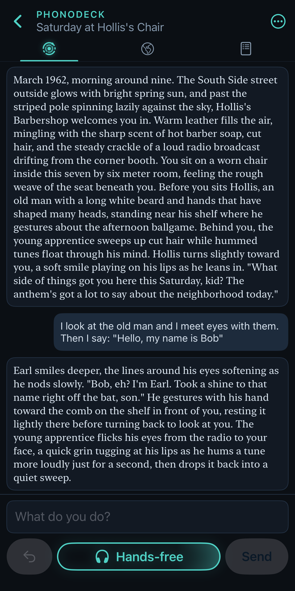
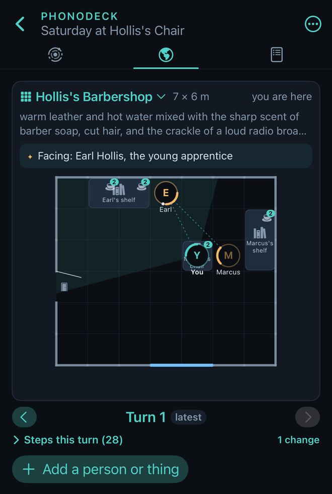
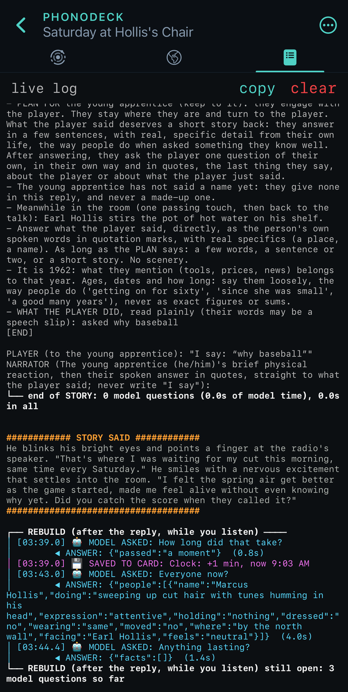
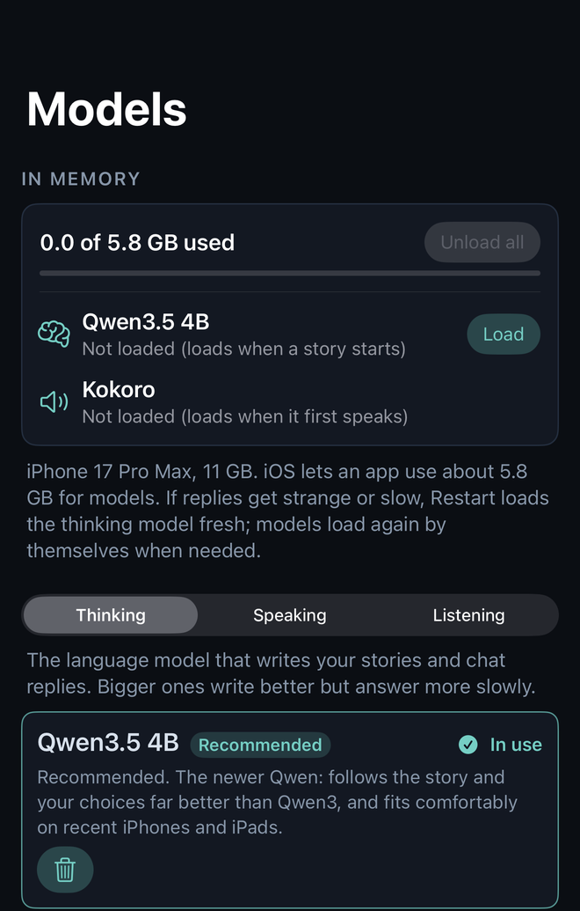
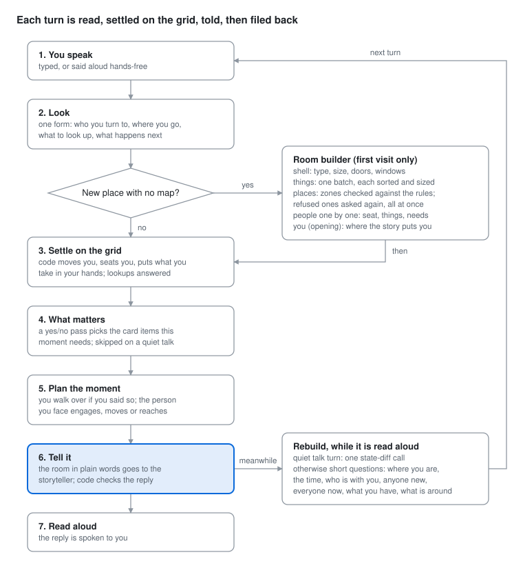

# Phonodeck for iPhone

An audio storytelling app that runs entirely on your iPhone. You download a language model once, and from then on it works in Airplane Mode: nothing you say or write leaves the phone.

<p align="center">
  
  
  
  
</p>
<p align="center"><sub>The story, the World map, the Live log, and the Models tab.</sub></p>

- **Phonodeck tab:** tap **Set up a new experience**. A short wizard asks how long you have, then offers curated worlds or walks you through building your own (the storyteller suggests answers if you pause). A build screen shows the world being made, ending with the first room drawn on the map, and the opening is told from it. The story has no clock: it runs until you choose **Finish the experience now** in the ••• menu. Then **Continue** starts the next part, with the same cast and world, a "last time" recap, and the story's facts and scene carried over. The parts are linked on the start screen.
- **Playing:** type, or tap **Hands-free** and just talk. With **Do, then say** (Settings, on by default) each spoken turn has two parts, each with its own chirp: first what you do, then what you say (or "nothing"). Say **"make it so"** to send.
- **Three tabs along the top of a story:** the story itself (the Phonodeck mark), the **World** (the globe: a map of the room you are in, the cards of everyone and everything in it, and a turn guide showing how each turn was worked out), and the **Live log** of every question the model was asked. Tap anything on the map to open its card; edit any card and your words win.
- **Chat tab:** a plain conversation with the same on-device model.
- **Models tab:** download the models for **Thinking** (the storyteller), **Speaking** (the narrator) and **Listening**. Every model shows whether it will run comfortably on *this* phone before you download it. Search Hugging Face or paste a link to add another.
- **Share experiences:** export a set-up as a small `.phonodeck` file and send it to someone; they tap it to import.
- **Privacy and support:** your stories and chats are encrypted on the phone. An optional passcode (or Face ID) locks Phonodeck whenever you leave it. Settings and the lock screen link to the 988 crisis line, and a check-in card offers it if something you write sounds like you might hurt yourself.

This is the on-device sibling of the [Phonodeck web app](https://github.com/simbonk/phonodeck), which uses Gemini in the cloud.

## The models

All are free, and all run offline once downloaded.

| Job | Fast | Medium | Good, slower |
|---|---|---|---|
| **Storyteller** | Llama 3.2 3B (1.8 GB), Gemma 4 E2B (3.6 GB download) | **Qwen3.5 4B (2.9 GB, recommended)**, Gemma 4 E4B (5.1 GB download, about 4 GB in memory) | Qwen3.5 9B (5.9 GB, 12 GB phones) |
| **Narrator voice** | Apple's built-in voices (no download) | Kokoro (0.35 GB) | Qwen3-TTS (1.9 GB) |
| **Listening** | Apple dictation (no download) | Parakeet Small (0.45 GB) | Parakeet 0.6B (2.5 GB) |

Small on-device models tell shorter, simpler stories than Gemini Pro, so the prompts here are a lighter version of the web app's.

## How a turn works

Every story plays on a **room grid**: each room is a grid of 1 m squares, and code holds where every person and thing is, which way they face, and what they wear and hold. The storyteller never sees the grid, only code's reading of it in plain words ("Dolores: in front of you, 1 m, behind the bar, facing you").



1. **Look.** One short call reads your message into fixed choices: who you turn to, where you go, what to look up, what happens next.
2. **Build the room** (first visit only). A new place is laid out before the reply: its size, doors and windows, the things the story names, where each one goes (checked against placement rules), and each person, one at a time. You watch it go up on the map.
3. **Settle.** Code moves you, seats you and puts what you take in your hands, and answers each lookup from the store.
4. **What matters.** One yes/no pass picks which card items this moment needs (`Fovea.swift`). On a quiet turn, talking to one person and staying put, it is skipped: the reply gets just the two of you.
5. **Plan the moment.** On the map: you walk over if you said so, and the person you face stays, gets up or reaches for what is near.
6. **Tell it.** The reply is written from short rules, the premise, the room in words and that narrow view, then checked in code (names, pronouns, people who are elsewhere, near-copies of earlier replies) before it is read aloud.
7. **Rebuild.** While it is read aloud, the grid and the cards catch up: one state-diff call after a quiet turn, short questions otherwise. Questions about things that were out of view are skipped.

The World tab's turn guide shows each step, and "Copy story text" in the ••• menu copies the world, the room maps and every turn with what happened behind the scenes.

**Continue.** When you finish a story, Continue starts its next part at the length you pick, right where it left off or some time later. One short call reads the final scene (where you are, the time, who is where, what is true now, and a recap), the returning people, places and facts carry over, and recall can search earlier parts.

**Memory.** Only one model call runs at a time, and every prompt is held to the 4,096-token conversation size the fit check below budgets for, so the extra steps never raise peak memory above a normal turn.

## How it decides whether a model fits

iOS lets each app use only part of the phone's memory. The app asks iOS how much it may use (`os_proc_available_memory`), then adds up what a model needs: its weights, the memory for a 4,000-token conversation (worked out from the model's own `config.json`, counting only the layers that remember the whole conversation), and some working room, plus whatever voice or listening model stays loaded beside it. Gemma 4 and Qwen3.5 ship with image and sound encoders the storyteller never loads, so the app reads the weight files' headers and leaves those out. Under 70% of the budget is **Runs comfortably**, under 92% is **Will run, but tight**, and above that is **Too big for this phone**. It also estimates speed (memory bandwidth divided by model size) so you know whether narration will keep up.

---

## Overnight tests

**Settings > Gameplay > Overnight tests** lets Phonodeck play its six sample stories by itself on the Thinking model while you sleep, and write a report for the morning. Nothing goes to the cloud.

- It builds each sample story's opening once (its baseline room). Then it plays blocks: a fresh copy of one baseline, 25 turns, then the next story's baseline, round and round until the stop time.
- The turns come from a bank of short scenarios in `Phonodeck/Tests/TestScenarios.swift` (someone walks in, leaving and coming back, asking a name, picking things up, an hour going by, doing and saying at once...), with some turns improvised by a simulated player. Each scenario plays a little differently every time: who it's about, what gets picked up, how a newcomer looks, and sometimes the words come out the way people really talk ("um, so I..."). A fixed core set keeps runs comparable, and a wide set adds new situations.
- After every turn, code checks the world: is the newcomer on the map and on a card, did the clock move the right amount and never backwards, are you where you went, holding what you took, sitting where you sat, are there no metres in the prose and are the pronouns right. Each check is one line: what it wanted, what happened, and the model question it blames with that question's answer.
- The report (`report.md`, shared from the same screen) leads with the pass rate of the scenario checks (the always-pass checks are counted apart), groups the failures by cause with counts, a few one-line examples and one or two full traces each, and compares every check's pass rate with the last run, so a big change can be checked by running the tests before and after.

**To run it on a Mac** (an Apple silicon Mac is faster than a phone): in Xcode, choose **My Mac (Designed for iPad)** as the run destination, press Run, download the Thinking model in the Models tab of the Mac copy, then open Settings > Overnight tests, set the stop time and tap **Start the tests**. On an iPhone, run it the same way, plugged in, with Phonodeck left open.

## Put it on your iPhone: step by step

You need a Mac, an iPhone or iPad on iOS 26 or later, and a USB cable. You've never built an app before? That's fine; these steps are all of it. The first build takes 10 to 20 minutes because Xcode downloads and compiles the AI libraries.

### 1. Install Xcode (once)

1. On the Mac, open the **App Store**, search for **Xcode**, and install it (it is free and large, about 10 GB). It needs a recent macOS; if the App Store says your Mac is too old, update macOS first in **System Settings > General > Software Update**.
2. Open Xcode once. It may ask to install extra components; say yes. When it asks which platforms you want, make sure **iOS** is ticked.
3. In Xcode's menu choose **Xcode > Settings > Accounts**, press **+**, choose **Apple ID**, and sign in with your normal Apple ID. This is free. (A paid Apple Developer account, $99/year, is only needed to share the app through TestFlight or keep it installed longer than 7 days at a time.)

### 2. Get the code (once)

1. Open the **Terminal** app on the Mac (press Cmd+Space, type Terminal, press Return).
2. Paste this and press Return:
   ```
   git clone https://github.com/simbonk/phonodeck-ios.git ~/phonodeck-ios
   open ~/phonodeck-ios/Phonodeck.xcodeproj
   ```
   If the Mac asks to install "command line developer tools", say yes, then paste the two lines again.

Xcode opens the project and starts fetching packages (you'll see "Resolving Package Graph" at the top). Wait for it to finish.

### 3. Get your iPhone ready (once)

1. Plug the iPhone into the Mac. On the phone, tap **Trust** and enter your passcode.
2. On the iPhone, open **Settings > Privacy & Security > Developer Mode**, turn it on, and let the phone restart. (If you don't see Developer Mode, do step 4 first; it appears after Xcode has seen the phone once.)

### 4. Sign and run

1. In Xcode's left sidebar, click the blue **Phonodeck** project icon at the top, then the **Phonodeck** target, then the **Signing & Capabilities** tab.
2. Tick **Automatically manage signing**, and choose your name under **Team** (it says "Personal Team").
3. If Xcode says the bundle identifier is not available, change **Bundle Identifier** to something unique, such as `com.yourname.phonodeck`.
4. At the top of the window, click the device menu (next to the Phonodeck scheme) and choose **your iPhone**.
5. Press the **Run** button (the ▶ triangle) or Cmd+R.
6. The first time, Xcode asks whether to **Trust & Enable** a package macro ("MLXHuggingFaceMacros"). Choose **Trust & Enable**; it's part of Apple's open-source MLX library and only generates code at build time.
7. The first time it installs, the iPhone may refuse to open the app. On the phone go to **Settings > General > VPN & Device Management**, tap your Apple ID under Developer App, and tap **Trust**. Then open Phonodeck.

### 5. First launch

1. A short welcome explains hands-free play, asks your date of birth (Phonodeck is adults only, 18 and over), and offers the recommended storyteller. On Wi-Fi, tap **Download** (green "Runs comfortably" means it fits).
2. On the same screen, tap **Listen** to hear each narrator voice. Apple's is ready at once; download **Kokoro** (medium) or **Qwen3-TTS** (good, slower) and listen again. Below that, pick how it hears you and tap **Try listening** to test it.
3. On the **Phonodeck** tab, tap **Set up a new experience** and follow the wizard. The first scene takes about a minute while the model loads and designs the world.

### Updating later

When there are new changes, in Terminal run:
```
cd ~/phonodeck-ios && git pull
```
then press Run in Xcode again. Your stories and downloaded models stay on the phone.

### The 7-day limit

With a free Apple ID, apps you install yourself stop opening after 7 days. Just plug the phone in and press Run in Xcode again; nothing is lost. A paid developer account removes this limit (and lets you add the **Increased Memory Limit** capability in Signing & Capabilities, which helps the bigger models; the entitlement is ready in `Config/Phonodeck.entitlements`).

### If something goes wrong

- **"No such module 'MLX…'"** or package errors: **File > Packages > Reset Package Caches**, then build again.
- **Metal toolchain missing** (Xcode 26 and later): in Terminal run `xcodebuild -downloadComponent MetalToolchain`, then build again.
- **"CodeSign failed" with "unable to build chain to self-signed root":** pull the latest code (`git pull`); the app now targets iOS 26, which avoids the extra library whose signing step trips over this.
- **"errSecInternalComponent" on a work or managed Mac:** the login keychain won't let `codesign` use the key. Put the signing certificate in its own keychain (for example `phonodeck-signing.keychain-db`) and, after a restart, unlock it with `security unlock-keychain ~/Library/Keychains/phonodeck-signing.keychain-db`.
- **`git pull` says local changes to project.pbxproj would be overwritten:** run `git checkout -- Phonodeck.xcodeproj`, pull, then pick your Team again in Signing & Capabilities.
- **The app freezes while Xcode is attached, and Xcode shows "failed assertion `bytes argument cannot be nil`":** that is Xcode's Metal checker, not a real fault. The shared scheme turns it off; if your copy still has it on, go to **Product > Scheme > Edit Scheme > Run > Diagnostics** and untick **Metal API Validation**. Press Stop in Xcode and run again.
- **Replies get strange or slow:** in the **Models** tab, under **In memory**, tap **Restart** next to the storyteller (or Unload to free memory).
- **The app closes while loading a model:** the model is too big for the phone's memory; pick a smaller one in the Models tab.
- **Silent narrator:** check the volume. Apple voices sound much better after you download a Premium or Enhanced voice in **Settings > Accessibility > Spoken Content > Voices**.

## Where things live

`Phonodeck/` is the app (Xcode picks up every file in it automatically).

- `LLM/`: the model catalog, Hugging Face downloads and the memory fit check (`DeviceFit.swift`), and running the language model with MLX (`LLMService.swift`).
- `Voice/`: the narrator (Apple, Kokoro, Qwen3-TTS) and listening (Apple dictation or Parakeet), including "make it so".
- `Story/`: the prompts (`Prompts.swift`, tune the storytelling here), curated experiences, the story engine (clock, director, memory, chapters, continue), saving and sharing.
- `Chat/`, `Models/`, `Settings/`: the other tabs, the lock screen, the privacy lock and the crisis line.
- `.github/workflows/build.yml`: GitHub checks that the app compiles on every push.

Built on [MLX Swift LM](https://github.com/ml-explore/mlx-swift-lm) and [MLX Audio Swift](https://github.com/Blaizzy/mlx-audio-swift).
